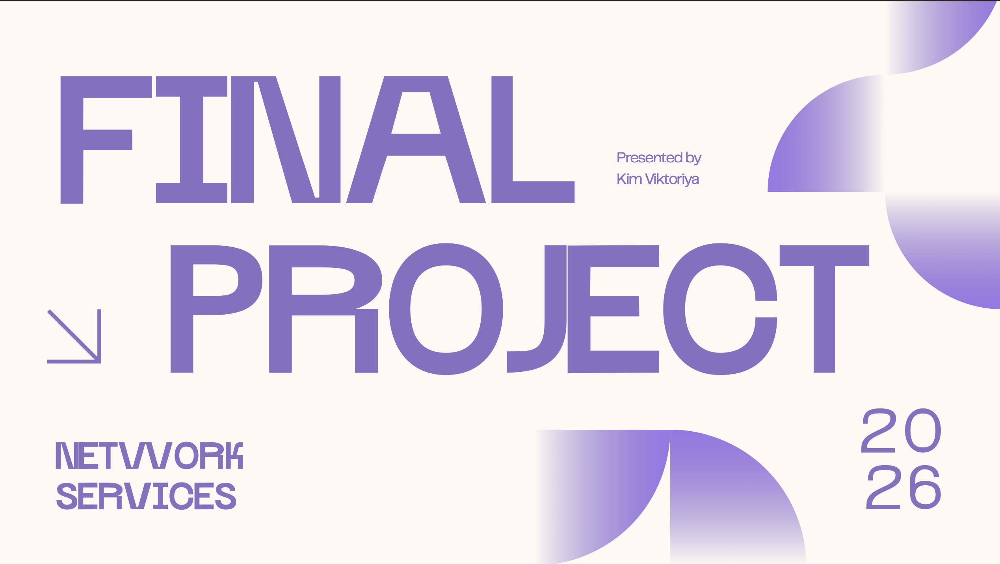

# Huawei-enterprise-network

**Tools:** Huawei eNSP | **Completed:** May 2026 | **Type:** Individual

An enterprise multi-site network architecture featuring inter-site tunneling, dynamic routing, traffic security, network services, and host OS cloud integration.

## Full Documentation
- [Presentation (PDF)](https://drive.google.com/file/d/1FKMEyrnuLJwoOjCW-cjZgJeuQBbYoq2s/view?usp=sharing)

## Key Features
- **Switching & Services:** Configured VLANs, RSTP (root/backup root with failover protection), Router-on-a-Stick, global DHCP pools, and an FTP server with AAA authentication.
- **Site-to-Site Tunneling & Security:** Connected sites using a GRE tunnel running OSPF/OSPFv3 (Area 0), protected with IPSec encryption (3DES/SHA1), Easy IP NAT, and WAN ACLs.
- **Management Hardening:** Configured STELNET (SSH, RSA 2048, AAA) and confirmed full end-to-end IPv4/IPv6 reachability.
